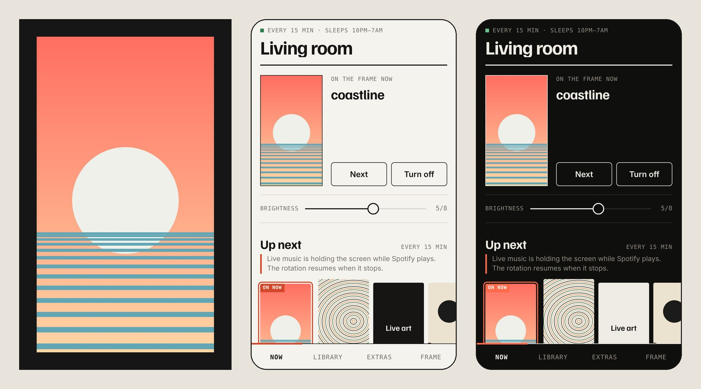
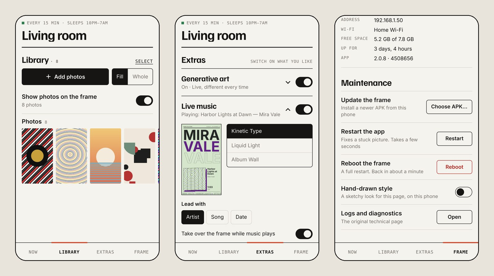
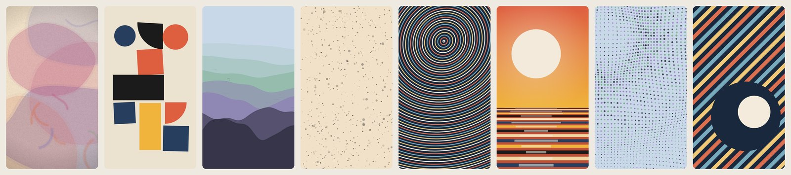
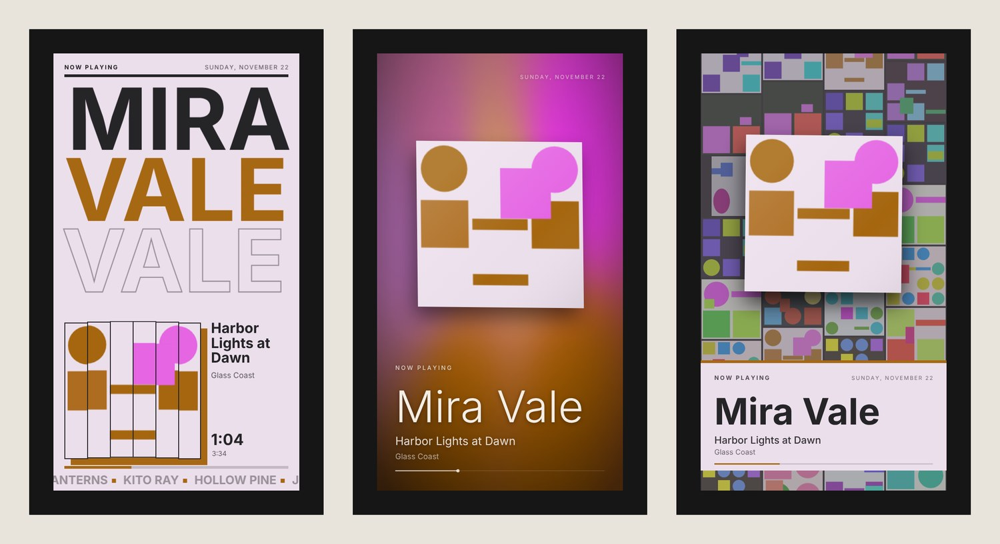

# EO2 Revival

**Bring an Electric Objects EO2 frame back to life after its servers shut down, and run it from your phone.**



Electric Objects frames were made to show art from a cloud service that no longer exists. This
project puts a replacement app on the frame and gives it a phone-friendly web page on your home
network. You can add photos and GIFs, choose what's in rotation, set how often pictures change and
when the screen sleeps, and put a few living things on the wall: today's newspaper front page or the
albums you've been playing. There are no accounts, no subscription and no cloud service in the middle.

> The frame app builds on [aphex3k/EO1](https://github.com/aphex3k/EO1) (a rewrite of
> [spalt/EO1](https://github.com/spalt/EO1)), with a phone page and extras added here. See
> [Credits](#credits).

## What you can do from your phone



- **Add photos and GIFs.** Photos are resized and converted on your phone before they're sent,
  so iPhone HEIC photos work and the frame gets small, ready-to-show files. Choose **Fill** (crop
  to the frame) or **Whole** (the full photo on a blurred background). Animated GIFs play as GIFs.
- **See what's coming up.** An Up next carousel shows what's on the frame now and what's next, with
  times, including the live art and music pages and the extras.
- **Manage the rotation.** Your library is laid out as one row per source (photos, kept art, NYT
  and Spotify). Tap a picture to preview it, **Show now** or **Remove** it, or select several.
- **Control the frame:** next picture, screen on or off, and a brightness slider.
- **Choose what's on the wall:** switch Photos, Generative art, the NYT front page and Spotify on or
  off in any mix, and choose how often art comes up.
- **Never fills up.** Old generated images (yesterday's front page, last week's album grid) are
  cleaned up automatically, and the frame refuses uploads that would nearly fill it.
- **Simple settings:** how often the picture changes (1 minute to 1 day), night-time sleep hours,
  time zone, and the frame's name.
- **Look after the frame:** update it, restart the app or reboot the frame from the Frame tab,
  no computer needed.
- **Four simple tabs:** Now, Library, Extras and Frame. Add it to your home screen and it opens
  like an app.

### Extras



- **Generative art.** Twelve animated styles (watercolor washes, Bauhaus blocks, rolling hills,
  drifting dots, contour rings, a striped sunset and more) drawn live on the frame. Every time a
  piece comes up it picks a new style and seed, so it's never the same twice. Pick which styles
  you like, preview them on your phone, and keep any frame you love as a still.



- **The New York Times front page.** Today's print front page, clean, glitched, or as an
  animated glitch GIF. Your phone fetches and renders it, and it replaces yesterday's.
- **Spotify, live.** Connect once from your phone and the frame keeps up with your music on its
  own. Three animated now-playing styles: **Kinetic Type** (a bold typographic poster that
  re-flows as tracks change), **Liquid Light** (the cover's colors flowing behind it) and
  **Album Wall** (your recent covers drifting in columns behind the current album). Lead with the
  artist, the song or the date, and let it take over the frame while music plays. There's also a
  still or animated grid of the albums you've played recently.
  One-time setup: [SPOTIFY-AND-TAILSCALE.md](eo2/SPOTIFY-AND-TAILSCALE.md).
- **Away from home:** reach the page over [Tailscale](eo2/SPOTIFY-AND-TAILSCALE.md#tailscale-the-phone-page-from-anywhere).

## Set up a frame (about 10 minutes, no keyboard)

The EO2 accepts Android's debugging connection (ADB) over Wi-Fi, so everything happens from a computer
on the same network. You need a Mac (or Linux, or Windows with WSL) and the frame on your Wi-Fi.

1. Download `setup-eo2.sh` from [`eo2/`](eo2/) and the frame app (`eo2-frame-*.apk`) from the
   [latest release](https://github.com/shellen/EO1/releases/latest). Put both in one folder.
2. In Terminal, from that folder:
   ```bash
   bash setup-eo2.sh
   ```
   The script installs `adb` if needed (via Homebrew), finds the frame on your network and turns
   off the original Electric Objects apps, so the "Select a home app" screen doesn't come back.
   It then asks for your time zone, interval and sleep hours, installs the app and reboots. It
   asks before every change.
3. Open `http://<frame-ip>:8080/` on your phone (the script prints the address) and add photos.

To install a newer build later: `bash update-eo2.sh <frame-ip>` with the new APK in the folder.
Manual steps and troubleshooting: [eo2/EO2-SETUP.md](eo2/EO2-SETUP.md).

**Security note:** the EO2 leaves ADB open on your network with full control of the frame, and the
phone page has no login. That's fine on a home network you trust. Don't put the frame on public or
guest Wi-Fi, and don't expose its page to the internet.

## What's in this repo

| Path | What it is |
|---|---|
| [`eo2/`](eo2/) | Everything for the EO2: setup and update scripts, guides, the phone page patch, the Spotify login bounce page, and an optional Mac script for a daily front page |
| [`eo2/patches/`](eo2/patches/) | The changes on top of aphex3k/EO1 (phone page, thumbnails, settings endpoint, brightness slider), with build steps |
| [`docs/images/`](docs/images/) | README images. All the art in them is generated, and the frame data shown is made up |
| `app/`, `app-partner/` | An earlier, unfinished replacement app for the EO1 and its Android companion, kept for reference. The EO2 setup above doesn't use them |

## Building the frame app

The APK is aphex3k/EO1 with [`eo2/patches/0001-mobile-web-page.patch`](eo2/patches/0001-mobile-web-page.patch)
applied. Build it with the Android SDK, signing with your own key; see
[eo2/patches/README.md](eo2/patches/README.md). Keep using the same key for later builds so
updates install in place.

## Credits

- **[aphex3k/EO1](https://github.com/aphex3k/EO1)**: the frame app this runs on (local uploads,
  Immich, Flickr, quiet hours, its TLS work for Android 4.4, and much more).
- **[spalt/EO1](https://github.com/spalt/EO1)** and **Dan Finkelstein**: the original replacement
  APK that started the revival, and the history of this repo.
- [Familjen Grotesk](https://github.com/Familjen-Sthlm/Familjen-Grotesk) (headings) and
  [Shantell Sans](https://github.com/arrowtype/shantell-sans) (the optional hand-drawn style) are
  bundled with the app under the SIL Open Font License.
- [pdf.js](https://mozilla.github.io/pdf.js/) and [gifenc](https://github.com/mattdesl/gifenc)
  are loaded by the phone page for the front page and the GIFs.

Not affiliated with Electric Objects, The New York Times, Spotify or Tailscale. The front-page
feature is meant for personal display at home; the scan is the Times' copyrighted work.
